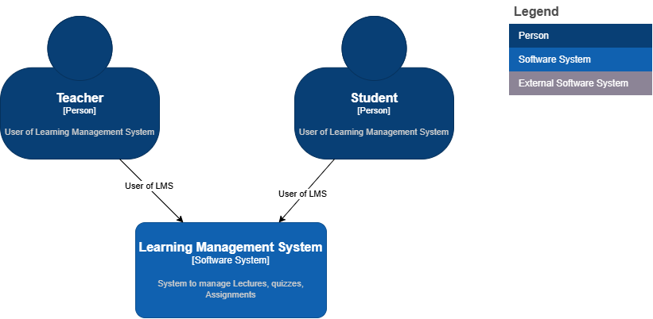
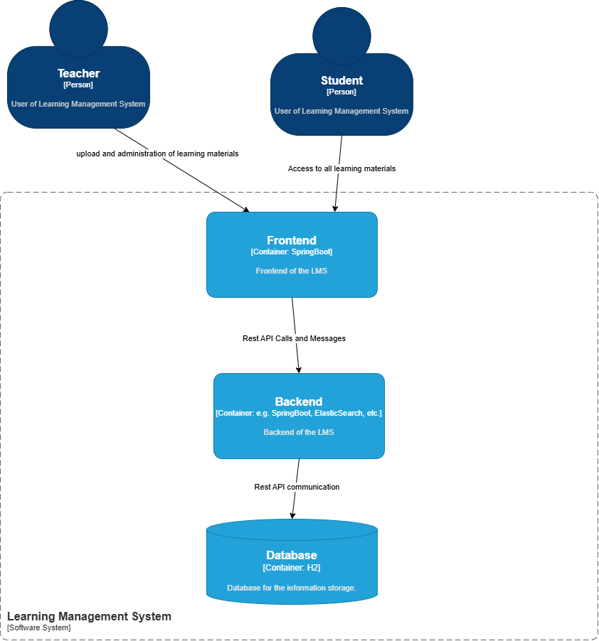

# Documentation - Learning Management System
## Group 10

## Overall Architecture

The Architecture of the learning Management System is a Three-Tier-Architecture. It is a form of the typical Client-Server-Tier. The reason for the usage of this Architecture is mainly in the Scalability of each Tier. We have a presentation tier, a logical tier and the data tier. 
the presentation tier with its react frontend has no ability to get straight to data. The Advantage of this is a higher security level for the data in the database. 
Another advantage of this architecture is the Maintainability and opportunity to work parallel in the different layers. 

Going deeper into the implementation, the system utilizes a polyglot persistence and event-driven approach:
* **Presentation Tier:** A React Single Page Application (SPA) that acts as the client, communicating via a RESTful API and authenticating statelessly using JSON Web Tokens (JWT).
* **Logic Tier:** A Java Spring Boot application that handles business rules[cite: 7]. It strictly enforces Role-Based Access Control (RBAC) on a per-course basis (e.g., verifying if a user is a teacher of a specific module before allowing edits)[cite: 7].
* **Data Tier:** Relational data (such as courses, users, and grades) is stored persistently in a PostgreSQL database via Hibernate, while binary file uploads are managed by MongoDB.

## Technology Stack

| Kategory         | Technology                 | Purpose                      | Explanation 
| ---------------- | -------------------------- | ---------------------------  | ------------
| Frontend         | React                      | Single Page Application      | - good for reusable UI components - ensure seamless user experience without page reload
| Frontend         | CSS Module                 | Style Sheet Application      | - strict structure and UI seperation - preventing style conflict
|                  |                            |                              |
| Backend          | Spring Boot                | Framework with Rest-API Calls| - reduce configuration effort - provides out-of-box modules for security and data access
| Backend          | Java                       | Programming Language         | - Primary programming language
| Backend          | Spring Security            | Stateless Authentication     | - Secure endpoints - using barer token for the sever-side validation
|                  |                            |                              |                           
| Database         | PostgreSQL                 | Relational Database          | - for structure entities like courses, students and teachers
| Database         | MongoDb                    | NoSQL Database               | -  effective for lag´rge files like lectures, writtenAssignment and Quizzes
|                  |                            |                              |
| Infrastructure   | RabbitMQ                   | Message Broker               | - asynchron communication between components to prevent API thread blocking
| Infrastructure   | Docker                     | Containerisation             | - ensures ideal environment for Database and Messager

## Development and Thought Process

The developement process followed an iterative AI-assisted approach. Initially, we read and analysed the task description and identified the requirements and functionality. Then, we discussed how we wanted to solve the task at hand and used AI to generate the code and implement the features. Our next step was to review all the generated code and test the system. This process was repeated through multiple rounds of testing, with AI assisting in coding and debugging, as well as adding new features along the way, such as our Kahoot feature. Throughout the entire process, we maintained quality controll and assesed the AI-generated soulutions. We made our own decisions and used the AI to execute them.

## New Technology

As a new Technology we had a view ideas. 
The final decision was to implement WebSockets in the Kahoot quiz (which is described in the next chapter).
The advantage of the WebSocket connection to the Kahoot quiz is the portal which is always open for receiving messages, without asking for new request. This reduces the  

## Novel Feature

## Known limitations, bugs and shortcomings 

## AI Usage Reflection

We used AI to generate all of the code as well as some debugging, as we agreed it would be most efficient. To quality assure the code we generated we reviewed and tested the code in several iterations.
AI models? Versions?