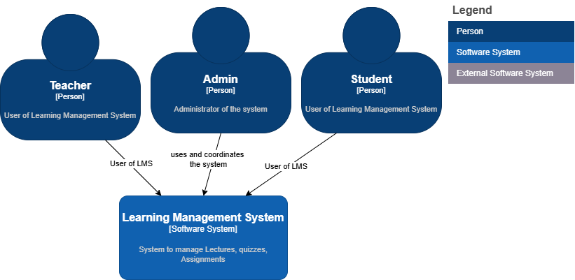
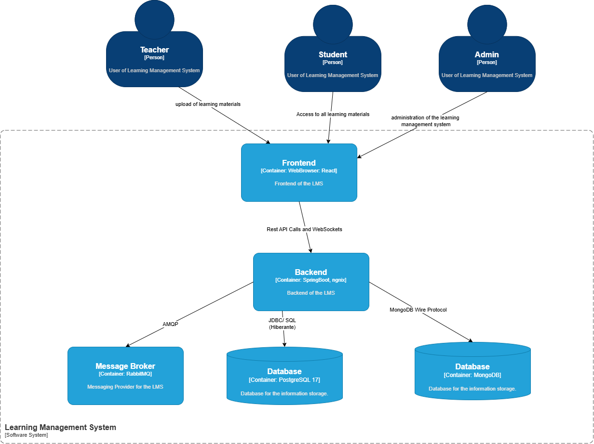

# Documentation - Learning Management System
## Group 10

## Overall Architecture

The Architecture of the learning Management System is a Three-Tier-Architecture, representing the typical Client-Server-Tier. The primary motivation for the usage of this Architecture is the scalability and security of each Tier. 
As shown in the first diagram, there is a presentation tier, a logical tier and the data tier. 
The presentation tier with its react frontend has no ability to get straight to data. The Advantage of this is a higher security level for the data in the database. 
Another advantage of this architecture is the Maintainability and opportunity to work parallel in the different layers. 

Going deeper into the implementation, the diagram above container through its different tiers even better. The presentation tier describes a single page application, with react as its technical component.
This tier is communication with REST APIs (especially /api/* and /api/ws) and JSON Web token for the authentication. 
This tier is running in a ngnix container on port 8080, which is described as web in the program. 
The frontend tier has no direct connection to the database and works stateless with Bearer tokens.

The second layer, known as the logic tier, works on Java and Spring Boot application. The components are saved in the fr.skyframe.lms folder. 
This tier has the global roles (STUDENT, TEACHER, ADMIN) to divide the access on the webPage in Course-Bound Role-Based Access Control. 
Every endpoint with Spring Security has trough @PreAuthorize expression dynamic Role-Based Control for every user.

The last layer, the Data tier, is a combination out of two databases. 
The usage of the PostgreSQL 17 database is for structured entities, like User, Course, CourseModule, StudentGroup, and a lot more. This database is managed by Hibernate/JPA to guarantee ACID compliance.
The MongoDB 7.0 Database is a no SQL database. This component is used for FileStorage form the Learning Management System. It is able to store files up to 20 MB without discrepancy in relational tables. 
The combination of these two databases is a cost-efficient model with a good structure and easy management for the administration. 
The entities and role structure is in the more expensive PostgreSQL database while at the same time bigger files and uploads are safed in the FileStorage of the MongoDB.

An addition to these three layers is the Event-Driven Messaging layer. This layer uses RabbitMQ 4 for asynchron notifications taking place in the live-quiz. 
For this layer, WebSockets are the Messaging tool to experience real-time answers of the program.

## Technology Stack

| Kategory         | Technology                 | Purpose                      | Explanation 
| ---------------- | -------------------------- | ---------------------------  | ------------
| Frontend         | React 18                      | Single Page Application      | - good for reusable UI modules - component-based architecture - ensure seamless user experience without page reload
| Frontend         | CSS Module                 | Style Sheet Application      | - strict structure and UI seperation - preventing style conflict
|Reverse Proxy      | ngnix                 |     Static Hosting                | - serves compiled React SPA - under single origin (8080) - proxies /api/* and /api/ws
| | | |
| Backend          | Spring Boot and Java 21          | Framework with Rest-API | - reduce configuration effort - provides out-of-box modules for security and data access - strong domain modeling
| | | |
| Security           | Spring Security            | Stateless Authentication and RBAC    | - Secure endpoints - using bearer token for the sever-side validation
|      |      |                              |            | Real-Time | WebSockets | Server-Push Live Channel | - for low-latency live quiz broadcasts - uses spring-Boot-starter-websocket and @stomp
| | | |
| Database         | PostgreSQL                 | Relational Database          | - for structure entities like courses, students, teachers and more - enforces referential integrity - ACID transactions
| Storage         | MongoDb                    | NoSQL Database and Binary File Storage         | -  effective for large files like lectures, writtenAssignment and Quizzes - splits uploaded files into 255 kB binary chunks
|| | |
| Messaging            | RabbitMQ 4     | Event Message Broker | - decouple domain event publication - asynchron in-app notification persistance
| | | |
| Infrastructure   | Docker                     | Containerization             | - ensures ideal environment for Database and Messager - multi-stage Dockerfiles -orchestrate all 5 containers with health checks

## Development and Thought Process

The development process followed an iterative AI-assisted approach. 
Initially, we read and analyzed the task description and identified the requirements and functionality. Then, we discussed how we wanted to solve the task at hand and used AI to generate the code and implement the features. 
Our next step was to review all the generated code and test the system. This process was repeated through multiple rounds of testing, with AI assisting in coding and debugging, as well as adding new features along the way, such as our Kahoot feature. 
Throughout the entire process, we maintained quality control and assessed the AI-generated solutions. 
We made our own decisions and used the AI to execute them.

## New Technology

The response of Standard REST APIs is based on a request from the browser. This technology is too slow for a live quiz, because every participant needs to see the answers at the exact same moment. 
After we compared HTTP Long Polling and Server-Sent Events, we select WebSockets combined with STOMP messaging protocol to push updates instantly over a persistent two-way connection.   
 

## Novel Feature

For more interaction during a lecture, the teacher can implement directly in the system a kahoot quiz. 
The teacher has a lot of features like putting a timer on, entering a PIN, decides the number of answers between 2 and 4 or choose multi-select questions.
For the point calculation we used LiveScoring based on speed and right answers. 

## Known limitations, bugs and shortcomings 

If we need a server restart during running the system, the live games will be annulled. We only have one backend instance, so only one live quiz can be active at the same time in a course.
Another shortcut we have, is that only the administrator can put the roles on every user.
The teacher now has to create every course and can't get it out of a database yet.
Another shortcut we have is, that the whole system is running local, so Students created on one device are not on another device until we have a commit.

## AI Usage Reflection

As described before, the learning management system is based on a one shot vibecoding with some more features added.
For a lot of the coding part we used Claude Pro. 
Another AI we used for resolve some issues is Gemini Pro.